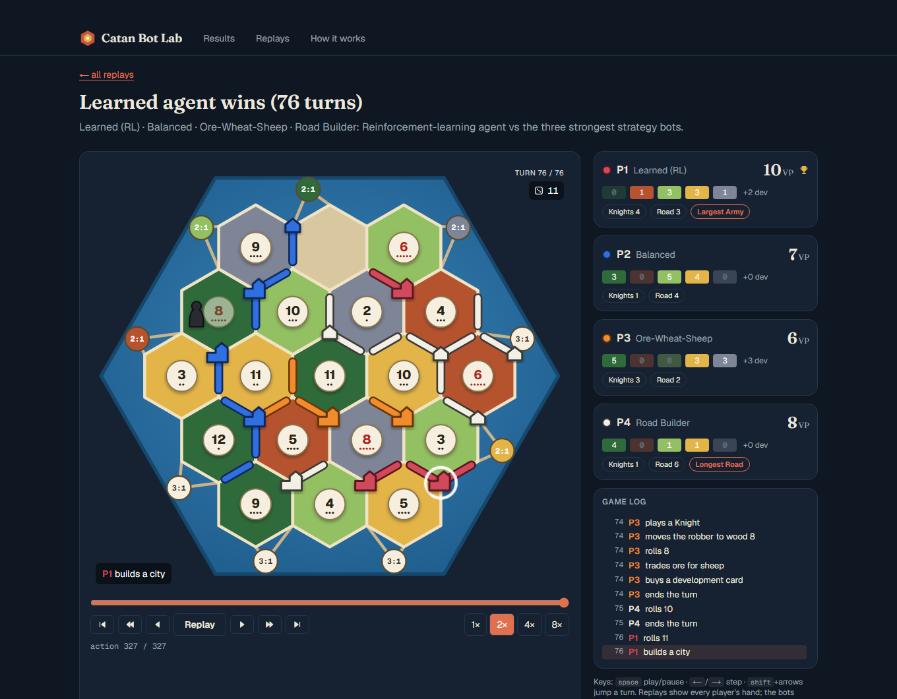

# Catan Bot Lab

**Can a self-taught AI beat the best Settlers of Catan strategies?**

I turned the Catan community's best-known strategies into bots, simulated millions of games to measure
them, tuned them with parameter sweeps, and trained a neural network with reinforcement learning, a
curriculum and a self-play league. The network was never shown a strategy: it was rewarded for victory points
early on, and after that only for winning.



| | |
|---|---|
| **Engine** | Rust, full 4-player base game (bank and harbour trades), **~43,000 random games/s** and **~9,700 strategy-bot games/s** on a 6-core desktop |
| **Strategies** | Ore-Wheat-Sheep, Road Builder, Dev-Card Rush, Port Master and Balanced, as one parameterised heuristic bot |
| **Simulation** | Seat rotation + common random numbers + Wilson confidence intervals; **2,000,000-game** headline tournament |
| **Learning** | PPO with action masking and a graph network over the board, per-seat GAE, curriculum then league with prioritised fictitious self-play (PyTorch, one GTX 1660 Ti) |
| **Website** | Static Next.js site with an interactive replay viewer, built for Vercel (`web/`) |

## Results

<!-- RESULTS:START -->
### Which strategy wins? (2,000,000 games, tuned bots, random 4-of-5 tables, all seats rotated)

| Strategy | Win rate | 95% CI | Avg VP | How it wins |
|---|---|---|---|---|
| Balanced | **37.6%** | 37.6–37.7% | 7.95 | Longest Road in 53% of its wins |
| Ore-Wheat-Sheep | 28.7% | 28.6–28.7% | 7.50 | 2.5 cities per game, Largest Army in 68% of its wins |
| Road Builder | 22.9% | 22.9–23.0% | 7.38 | Longest Road in 96% of its wins |
| Dev-Card Rush | 20.3% | 20.2–20.3% | 6.99 | 7.8 dev cards per game, Largest Army in 94% of its wins |
| Port Master | 15.5% | 15.5–15.6% | 6.57 | most bank trades (9.1 per game) |

25% is break-even at a four-player table. Seat matters too: the first player wins 27.5% of games and the
fourth 22.2%, which is why every comparison here rotates seats.

### Small changes, big swings

Coordinate-ascent tuning (about 8 million games) with each strategy's resource preferences held fixed:

| Strategy | Hand-written | Tuned | What mattered |
|---|---|---|---|
| Balanced | 46.1% | 53.4% | stronger diversity and harbour bonuses, never discard |
| Ore-Wheat-Sheep | 21.7% | 37.7% | **expand**: settlement priority 0.75 → 1.41, fewer dev cards |
| Road Builder | 23.4% | 33.8% | more diversity, *less* Longest-Road obsession |
| Dev-Card Rush | 7.3% | 26.8% | buy fewer cards (priority 1.8 → 1.5), build cities and settlements |
| Port Master | 26.2% | 27.5% | its defining idea, specialisation, is a net loss (see sweep) |

(Win rates against a field of the four other hand-written strategies.)

### The learning agent

8,000 PPO updates: 262 million decisions over 2.6 million training games, 16 hours on one GTX 1660 Ti.
Then 40,448 evaluation games against the three strongest tuned strategies, all seats rotated:

| Player (same games) | Win rate | 95% CI |
|---|---|---|
| Balanced | 30.5% | 30.0–30.9% |
| Ore-Wheat-Sheep | 24.7% | 24.3–25.1% |
| **Learned agent** | **24.1%** | 23.7–24.6% |
| Road Builder | 20.7% | 20.3–21.1% |

**Close, but not yet.** The agent is level with Ore-Wheat-Sheep and clearly ahead of Road Builder, but the tuned
Balanced bot is still better: put in the agent's seat, it wins 28.3%. Across all ten tables of three
strategies, the agent averages 26.0%. It is above break-even at four of them (up to 30.1% against
Balanced, Road Builder and Port Master), level at three and below at three.

Its evaluation win rate against the top three rose from 4.9% (update 100) to 14.6% (update 1,200) and about
23% over the last 1,000 updates. It was still improving slowly when training stopped.

**What it learned.** Nobody showed it a strategy, and it settled on a hybrid of Ore-Wheat-Sheep and
Dev-Card Rush:

- it opens a little heavier on ore and wheat than Balanced (44% of opening production vs 40%);
- it buys 7.0 dev cards a game (Dev-Card Rush 7.8, Balanced 1.7);
- it holds Largest Army at the end of half its games;
- it almost ignores Longest Road (7% of games vs 29% for Balanced).

In the games it wins, its 10 points come on average from cities (4.8 VP), hidden VP cards (2.0) and
Largest Army (1.5).
<!-- RESULTS:END -->

Full charts: the [website](web/) and the notebooks in [`notebooks/`](notebooks/).

## How it works

```
crates/catan-core   Rust: board topology, rules, bots, tournaments, observation encoding, vectorised RL env
crates/catan-cli    `catan-sim`: benchmarks, tournaments, replay export
crates/catan-py     PyO3 bindings -> python module catanbot._engine
python/catanbot     training (PPO + league), evaluation, sweeps, analysis pipeline
notebooks/          01 tournament · 02 tuning & sweeps · 03 training · 04 what the AI learned
web/                static Next.js site (replay viewer, results, write-up), deployable to Vercel
```

**Engine.** A game state is a fixed-size `Copy` struct with no heap allocation. Board, dice, dev deck and steals
each draw from their own seeded RNG stream, so a game is fully determined by its seed and its moves. That makes
replays exact and lets every variant in a comparison play the same boards and dice (common random numbers).
25 Rust tests cover the tricky rules (Longest Road breaking, discards, dev-card timing, the bank-shortage rule,
harbours) and re-check invariants after every action of 420 full games.

**Strategy bots.** One goal-driven heuristic: pick the most valuable build (city, settlement, road, dev card),
discounted by how far away it is; build it, trade toward it, spend spare cards, and stay safe from the robber.
Presets set about 15 weights. Bots only use public information plus their own hand.

**Learning agent.** It observes 1,652 features from its own seat's point of view (no hidden cards) and chooses
from 252 actions with a legality mask. The policy is a graph network: tiles, intersections and roads are
embedded by networks shared across the board, with message passing between neighbouring intersections, and
settlement/city/road/robber actions are scored per entity. On identical settings it learned about 3× faster
than a flat MLP. Forced moves are auto-played inside Rust. The Rust `VecEnv` advances bot
seats and dice in parallel and only returns to Python when a network has to decide. PPO links each seat's own
decisions into a trajectory for GAE. Training runs as a curriculum (random → weaker strategies → all tuned
strategies), then a league in which each opponent is a strategy bot, a frozen past copy of the agent, or the
agent itself. Opponents are drawn with prioritised fictitious self-play.

## Reproduce

Requirements: Rust (stable), [uv](https://docs.astral.sh/uv/), Node 22; a CUDA GPU is optional.

```bash
# Python environment + engine bindings
uv venv --python 3.12
uv pip install torch --index-url https://download.pytorch.org/whl/cu128   # or /whl/cpu
uv pip install -e ".[dev]"          # builds the Rust extension with maturin
# (after editing Rust: maturin develop --release --uv)

# Tests
cargo test -p catan-core --release
pytest -q

# Simulate
cargo run --release -p catan-cli -- bench --bots ows,road_builder,dev_rush,balanced
cargo run --release -p catan-cli -- tournament --bots ows,road_builder,dev_rush,balanced --seeds 25000
python -m catanbot.sweep tune                      # tune the strategies (~15 min)
python -m catanbot.pipeline tournament --seeds 500000
python -m catanbot.pipeline sweeps

# Train and evaluate (~16 hours on a GTX 1660 Ti, resumable; step-by-step guide: docs/TRAINING.md)
python -m catanbot.train --config configs/main.yaml
python -m catanbot.pipeline evaluate --checkpoint runs/main/checkpoints/latest.pt --games 40000
python -m catanbot.pipeline style    --checkpoint runs/main/checkpoints/latest.pt --games 8000
python -m catanbot.pipeline replays  --checkpoint runs/main/checkpoints/latest.pt

# Website data + site
python -m catanbot.pipeline export
cd web && npm install && npm run dev
```

Custom bots are JSON specs: `python -c "import catanbot; print(dict(catanbot.presets())['ows'])"`, then edit and pass
the JSON (or a `.json` file path) anywhere a bot name is accepted.

## Limitations

- No player-to-player trading, which is a large part of human Catan.
- The strategy bots are my implementations of community strategies, tuned in simulation; strong human players
  would play each strategy better.
- Four-player Catan isn't two-sided zero-sum, so results are reported against specific, named lineups.

Not affiliated with or endorsed by the publishers of CATAN®. No official artwork is used.
